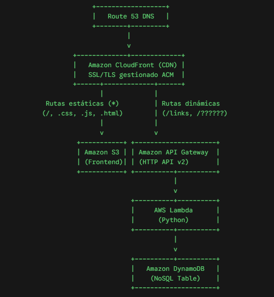

# ⚡ Shorty - Serverless URL Shortener

> Acortador de URLs *cloud-native*, seguro y de alta disponibilidad desplegado sobre AWS con arquitectura serverless desacoplada y dominio personalizado.

🌐 **Demo en vivo:** <https://shortyshortener.me>

## 📌 Arquitectura del Sistema

El sistema utiliza un único punto de entrada perimetral con Amazon CloudFront que distribuye el tráfico entre un frontend estático alojado en S3 y una API REST serverless:

  

## 🛠️ Stack Tecnológico

* **Edge / CDN & DNS:** AWS CloudFront, Route 53, AWS Certificate Manager (ACM).

* **Frontend:** HTML5, CSS3, JavaScript Vanilla (SPA estática alojada en Amazon S3).

* **API / Cómputo:** Amazon API Gateway (HTTP API v2), AWS Lambda (Python 3.12).

* **Persistencia:** Amazon DynamoDB (On-Demand).

## 🧠 Retos de Ingeniería y Decisiones de Diseño

### 1. El laberinto del dominio personalizado (Route 53, ACM y CloudFront)

Integrar un dominio propio (`shortyshortener.me`) con una arquitectura multiorigen en AWS requiere sortear varias restricciones arquitectónicas estrictas:

* **Dependencia regional de ACM (`us-east-1`):** Aunque el backend (Lambda, API Gateway, DynamoDB) se encuentre en regiones locales (como `eu-south-2`), CloudFront exige de forma mandatoria que los certificados SSL/TLS se soliciten y emitan en la región de `us-east-1` (N. Virginia).

* **Validación DNS y propagación:** Coordinar la zona alojada en Route 53 creando registros CNAME específicos para la validación automática del certificado, esperando la propagación antes de vincular los nombres de dominio alternativos (CNAMEs) en la distribución.

* **Mapeo de registros Alias:** Creación de registros Alias tipo A y AAAA apuntando hacia la distribución de CloudFront en lugar de usar IPs estáticas, habilitando soporte IPv6 y balanceo global Anycast.

### 2. Convivencia entre S3 y API Gateway bajo la misma raíz

El reto principal consistía en servir la web estática en la raíz (`/`) y al mismo tiempo permitir enlaces cortos limpios (`shortyshortener.me/{id}`) sin colisionar con los archivos del frontend:

* **Enrutamiento por longitud exacta (`??????`):** En lugar de forzar prefijos antiestéticos como `/links/{id}`, se configuró un *Cache Behavior* prioritario con el patrón glob `??????` (6 caracteres) apuntando a API Gateway (`GET /{id}`).

* **Aislamiento del frontend:** El comportamiento por defecto (`Default (*)`) delega en el bucket S3 para servir `index.html`, estilos y recursos estáticos.

* **Creación de enlaces:** El endpoint de creación utiliza `POST /links` mediante un comportamiento dedicado que reenvía cabeceras y métodos necesarios sin almacenamiento en caché (`CachingDisabled`).

### 3. Seguridad y Blindaje de la API

* **Protección contra XSS y esquemas arbitrarios:** Validación exhaustiva con `urllib.parse` para restringir el protocolo estrictamente a `http://` y `https://`, bloqueando esquemas maliciosos como `javascript:`, `data:` o `file:`.

* **Mitigación de CRLF / HTTP Header Injection:** Sanitización contra caracteres de control (`\r`, `\n`, `\0`, `\t`) para proteger la cabecera `Location` durante la redirección HTTP 301.

* **Control de bucles (Open Redirect Loops):** Bloqueo en la Lambda para impedir el auto-acortado de enlaces pertenecientes al propio dominio `shortyshortener.me`.

* **Mitigación de colisiones atómicas:** Escrituras en DynamoDB con condición atómica `attribute_not_exists(id)` combinadas con reintentos automáticos ante colisiones de clave.

## 🚀 Despliegue y Configuración

### 1. Backend (AWS Lambda & DynamoDB)

1. Crear una tabla en DynamoDB llamada `url-shortener` con clave de partición `id` (String).

2. Desplegar el código de `backend/lambda_function.py` en una función Lambda (Python 3.12).

3. Asignar un rol IAM con políticas para `dynamodb:PutItem` y `dynamodb:GetItem`.

4. Configurar una HTTP API en API Gateway con las siguientes rutas integradas a la Lambda:

   * `POST /links`

   * `GET /{id}`

### 2. Frontend (Amazon S3)

1. Crear un bucket S3 privado.

2. Subir los archivos estáticos (`index.html`, estilos, scripts).

3. Configurar Origin Access Control (OAC) en CloudFront para acceso de lectura seguro y restringir acceso público directo al bucket.

### 3. Edge & Distribución (CloudFront & Route 53)

1. Solicitar certificado SSL en AWS Certificate Manager **obligatoriamente en la región `us-east-1`**.

2. Crear los registros de validación DNS en Route 53.

3. Crear la distribución de CloudFront asociando ambos orígenes (S3 y API Gateway) con los comportamientos en el siguiente orden de precedencia:

   1. `links*` ➔ Origen API Gateway (Métodos `POST, OPTIONS`, CachingDisabled).

   2. `??????` ➔ Origen API Gateway (Métodos `GET, HEAD`, CachingDisabled).

   3. `Default (*)` ➔ Origen S3 (Métodos `GET, HEAD`).

4. Crear registros Alias (A y AAAA) en Route 53 apuntando el dominio a la distribución de CloudFront.